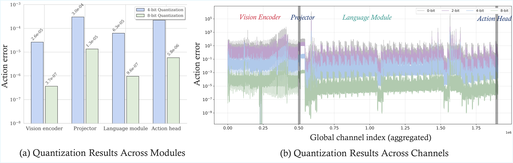

# QVLA: Not All Channels Are Equal in Vision-Language-Action Model's Quantization

<div align="center">
    <p>
        <a>Yuhao Xu</a><sup>1</sup>&nbsp;&nbsp;
        <a>Yantai Yang</a><sup>1,2</sup>&nbsp;&nbsp;
        <a>Zhenyang Fan</a><sup>1</sup>&nbsp;&nbsp;
        <a>Yufan Liu</a><sup>3,4</sup>&nbsp;&nbsp;
        <br>
        <a>Yuming Li</a><sup>5</sup>&nbsp;&nbsp;
        <a>Bing Li</a><sup>3</sup>&nbsp;&nbsp;
        <a>Zhipeng Zhang</a><sup>1</sup>&nbsp;&nbsp;
    </p>
    <p>
        <sup>1</sup>AutoLab, School of Artificial Intelligence, Shanghai Jiao Tong University&nbsp;&nbsp;
        <br>
        <sup>2</sup>Anyverse Dynamics&nbsp;&nbsp;
        <br>
        <sup>3</sup>State Key Laboratory of Multimodal Artificial Intelligence Systems, Institute of Automation, Chinese Academy of Sciences&nbsp;&nbsp;
        <br>
        <sup>4</sup>School of Artificial Intelligence, University of Chinese Academy of Sciences&nbsp;&nbsp;
        <br>
        <sup>5</sup>Terminal Technology Department, Alipay, Ant Group
    </p>
</div>

<p align="center">
  <a href="https://arxiv.org/abs/2602.03782">
    
  </a>
</p>


QVLA provides action-sensitivity calibration, channel-wise bit allocation, and
quantization for evaluation or checkpoint export. The standalone OpenVLA and
OpenVLA-OFT W4A16/W8A16 workflow is documented in
[the weight-only guide](docs/weight_only.md).

## 📰 News

- [Jan 26, 2026] Accepted to ICLR 2026.

## 📖 Abstract

The advent of Vision-Language-Action (VLA) models represents a significant leap
for embodied intelligence, yet their immense computational demands critically
hinder deployment on resource-constrained robotic platforms. Intuitively, low-bit
quantization is a prevalent and preferred technique for large-scale model
compression. However, we find that a systematic analysis of VLA model's
quantization is fundamentally lacking. We argue that naively applying uniform-bit
quantization from Large Language Models (LLMs) to robotics is flawed, as these
methods prioritize passive data fidelity while ignoring how minor action
deviations compound into catastrophic task failures. To bridge this gap, we
introduce QVLA, the first action-centric quantization framework specifically
designed for embodied control. In a sharp departure from the rigid, uniform-bit
quantization of LLM-based methods, QVLA introduces a highly granular, channel-wise
bit allocation strategy. Its core mechanism is to directly measure the final
action-space sensitivity when quantizing each individual channel to various
bit-widths. This process yields a precise, per-channel importance metric that
guides a global optimization, which elegantly unifies quantization and pruning
(0-bit) into a single, cohesive framework. Extensive evaluations on different
baselines demonstrate the superiority of our approach. In LIBERO, the quantized
OpenVLA-OFT with QVLA requires only 29.2% of the original model's VRAM while
maintaining 98.9% of its original performance and achieving a 1.49x speedup.
This translates to a 22.6% performance improvement over SmoothQuant.

## ✨ Highlights

- OpenVLA/OpenVLA-OFT weight-only routes allocate `{0,4,8,16}` output-channel bits with a default 1% per-layer pruning cap.
- Works on `language_model.*` and `vision_backbone.*` Linear/Conv2d layers.
- Excludes `projector.*`, `action_head`, and `language_model.lm_head`.

## 🖼️ Figure
Sensitivity Analysis


## 📁 Repository Layout

- `openvla/` OpenVLA source code and dependencies
- `openvla/qvla/` Causal soft-action calibration, allocation, guarded evaluation and CPU checks
- `openvla-oft/` OpenVLA-OFT source and pinned bidirectional inference dependencies
- `openvla-oft/qvla/` Native continuous-action calibration, allocation, guarded evaluation and CPU checks
- `scripts/run_qvla.py` Standalone stage runner for both weight-only backends
- `docs/weight_only.md` Setup, method scope, recipes and artifact contracts
- `UniVLA/` UniVLA source and its backend-specific QVLA scripts

## 🚀 Reproduce the Spatial weight-only workflow

Start with the [complete step-by-step guide](docs/weight_only.md#start-here).
It includes copyable environment, LIBERO config, model/data download, startup,
full-evaluation and result-verification commands. The steps below summarize the
order and show all four full-evaluation configurations.

### 1. Fetch this implementation

These scripts are currently delivered in [PR #9](https://github.com/AutoLab-SAI-SJTU/QVLA/pull/9).
Until it is merged, fetching only `main` gives the earlier implementation:

```bash
git clone https://github.com/AutoLab-SAI-SJTU/QVLA.git
cd QVLA
git fetch origin pull/9/head
git checkout --detach FETCH_HEAD
export QVLA_ROOT="$PWD"
export OPENVLA_PYTHON="$QVLA_ROOT/.venv-openvla/bin/python"
export OFT_PYTHON="$QVLA_ROOT/.venv-oft/bin/python"
```

### 2. Install the selected backend and LIBERO

Follow [backend installation](docs/weight_only.md#install-the-selected-backend)
and [LIBERO/headless setup](docs/weight_only.md#set-up-libero-and-headless-simulation).
Use Python 3.10 and PyTorch 2.2.0. OpenVLA and OFT require separate environments:
causal Transformers 4.40.1 versus the pinned author's bidirectional fork.
OpenVLA W8 additionally requires FlashAttention 2.5.5.

The guide clones a pinned LIBERO revision, installs it into the selected
backend environment(s), and creates a private `LIBERO_CONFIG_PATH`. It also sets
`LIBERO_ROOT`, `MUJOCO_GL=osmesa`, and `PYOPENGL_PLATFORM=osmesa`.

### 3. Download the checkpoint and training data

Follow the [pinned download commands](docs/weight_only.md#download-local-checkpoints-and-calibration-data).
The examples use these paths under the repository root:

| Asset | Local path |
| --- | --- |
| Merged OpenVLA Spatial checkpoint | `models/openvla_spatial/` |
| Merged OFT Spatial checkpoint, with action/proprio heads | `models/oft_spatial/` |
| Hugging Face `openvla/modified_libero_rlds`, all four suites | `data/modified_libero_rlds/` |

Existing local files can be used by changing the paths in the commands. The four
RLDS training suites are required even when evaluating only Spatial. LIBERO's
simulation assets and default initial states are also required; RLDS data alone
is insufficient for robot rollouts.

### 4. Check startup

The [startup command](docs/weight_only.md#check-startup-before-full-evaluation)
uses eight training frames and one trial per task in a separate output root.
Use it to check setup before a 512-frame calibration and full evaluation.
Its ten episodes are a startup check, not a full Spatial SR measurement.

### 5. Run W4A16 or W8A16

Run the selected configuration from the repository root, in the same shell as
the setup variables. Each command uses one visible GPU, 512 training calibration
trajectories, the Spatial suite, 50 trials per task and seed 7. The default
attention, pruning cap and OpenVLA W8 repair settings are selected automatically.
Use a fresh output root for each run.

**OpenVLA W4A16:**

```bash
CUDA_VISIBLE_DEVICES=0 "$OPENVLA_PYTHON" scripts/run_qvla.py \
  --backend openvla --checkpoint "$QVLA_ROOT/models/openvla_spatial" \
  --rlds-root "$QVLA_ROOT/data/modified_libero_rlds" \
  --task_suite_name libero_spatial --target-avg-bits 4 \
  --max-samples 512 --trials 50 --seed 7 \
  --output-root "$QVLA_ROOT/out/openvla_w4" --action run
```

**OpenVLA W8A16:**

```bash
CUDA_VISIBLE_DEVICES=0 "$OPENVLA_PYTHON" scripts/run_qvla.py \
  --backend openvla --checkpoint "$QVLA_ROOT/models/openvla_spatial" \
  --rlds-root "$QVLA_ROOT/data/modified_libero_rlds" \
  --task_suite_name libero_spatial --target-avg-bits 8 \
  --max-samples 512 --trials 50 --seed 7 \
  --output-root "$QVLA_ROOT/out/openvla_w8" --action run
```

**OpenVLA-OFT W4A16:**

```bash
CUDA_VISIBLE_DEVICES=0 "$OFT_PYTHON" scripts/run_qvla.py \
  --backend openvla-oft --checkpoint "$QVLA_ROOT/models/oft_spatial" \
  --rlds-root "$QVLA_ROOT/data/modified_libero_rlds" \
  --task_suite_name libero_spatial --target-avg-bits 4 \
  --max-samples 512 --trials 50 --seed 7 \
  --output-root "$QVLA_ROOT/out/oft_w4" --action run
```

**OpenVLA-OFT W8A16:**

```bash
CUDA_VISIBLE_DEVICES=0 "$OFT_PYTHON" scripts/run_qvla.py \
  --backend openvla-oft --checkpoint "$QVLA_ROOT/models/oft_spatial" \
  --rlds-root "$QVLA_ROOT/data/modified_libero_rlds" \
  --task_suite_name libero_spatial --target-avg-bits 8 \
  --max-samples 512 --trials 50 --seed 7 \
  --output-root "$QVLA_ROOT/out/oft_w8" --action run
```

`--trials 1` gives 10 episodes, `--trials 10` gives 100, and `--trials 50` gives
500. Only the last is the full Spatial protocol documented here. Do not compare
success rates from different episode counts as the same experiment.

## 📦 Read and verify the result

For example, after the OFT W8 run:

```bash
"$OFT_PYTHON" scripts/run_qvla.py --backend openvla-oft \
  --action result --output-root "$QVLA_ROOT/out/oft_w8"
"$OFT_PYTHON" openvla-oft/qvla/verify_eval.py \
  --run_dir "$QVLA_ROOT/out/oft_w8/logs/eval"
```

`merged_summary.json` reports `total_episodes`, `total_successes` and
`total_success_rate` (a fraction, multiplied by 100 for percent). A full Spatial
run must contain **500 episodes**, and independent log verification must report
`status: passed`. Use the matching backend/output directory for the other runs.
Runtime exceptions or incomplete logs are not valid SR measurements. See
[result verification](docs/weight_only.md#verify-the-result) and
[staged runs/exact input selection](docs/weight_only.md#staged-runs-and-exact-input-selection).

Calibration records, scores and assignments live under `calib/`, `proxy/` and
`gates/`; per-run metadata/logs/videos live under `logs/eval/`. Stage manifests
reject stale artifacts. Optional export writes a full BF16 fake-weight checkpoint.
The workflow uses BF16 activations/operators and does not provide packed integer
speedups. Method definitions and unreproduced paper stages are stated in the
[recipe/scope guide](docs/weight_only.md#recipes).

This update includes code and configuration only. Current experiment results,
weights, datasets, calibration records, scores, gates, logs and videos are not
bundled. The headline paper results above retain their original paper context;
these instructions reproduce the released workflow rather than guarantee every
paper SR. Separate CPU test environments cover both backends and the stage runner.

## 📚 Citation

```bibtex
@misc{xu2026qvlachannelsequalvisionlanguageaction,
      title={QVLA: Not All Channels Are Equal in Vision-Language-Action Model's Quantization}, 
      author={Yuhao Xu and Yantai Yang and Zhenyang Fan and Yufan Liu and Yuming Li and Bing Li and Zhipeng Zhang},
      year={2026},
      eprint={2602.03782},
      archivePrefix={arXiv},
      primaryClass={cs.CV},
      url={https://arxiv.org/abs/2602.03782}, 
}
```
